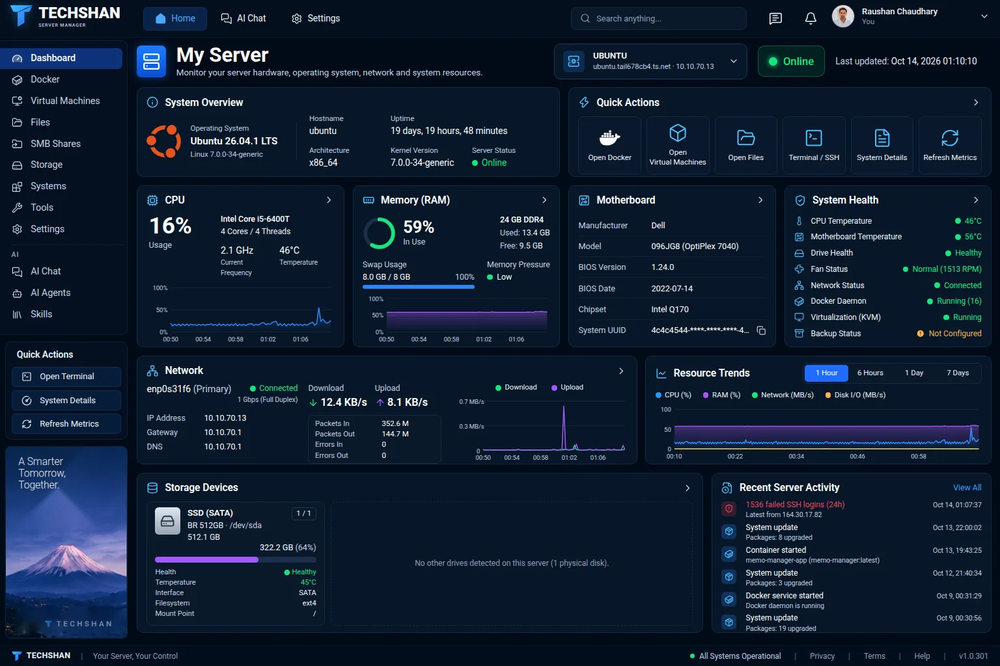
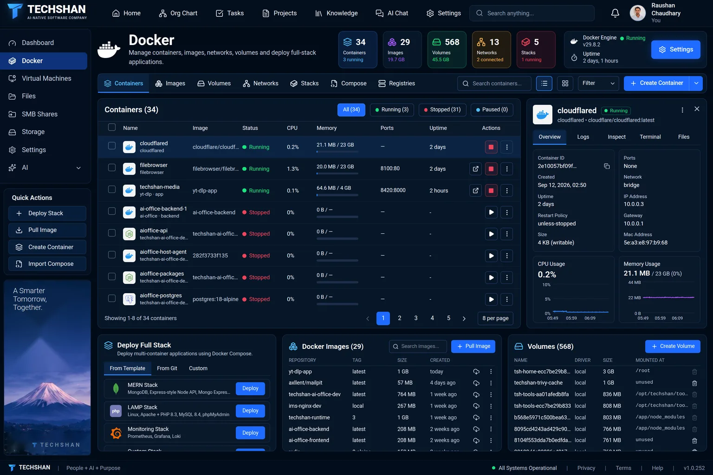
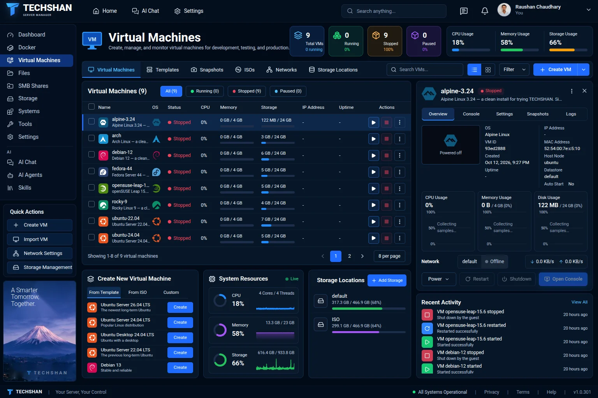
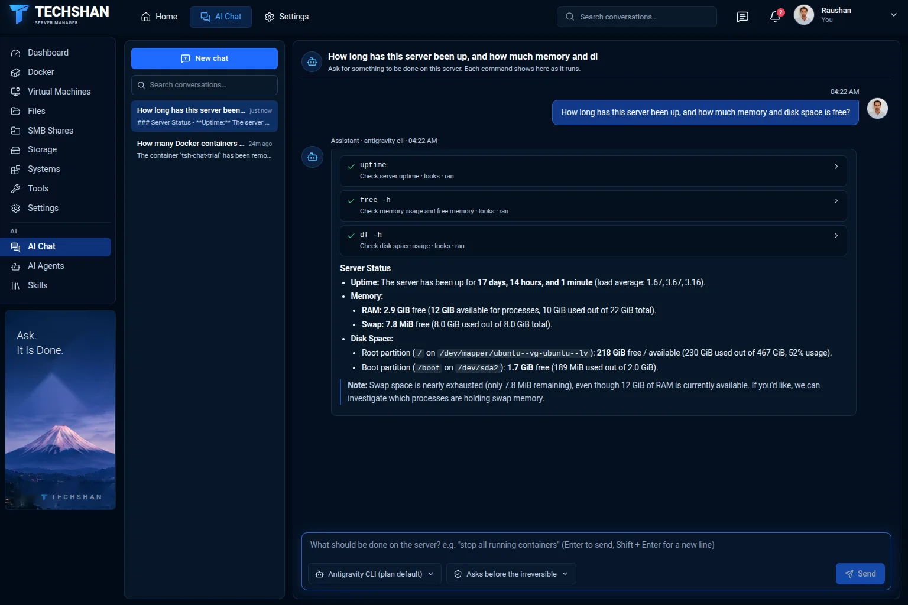
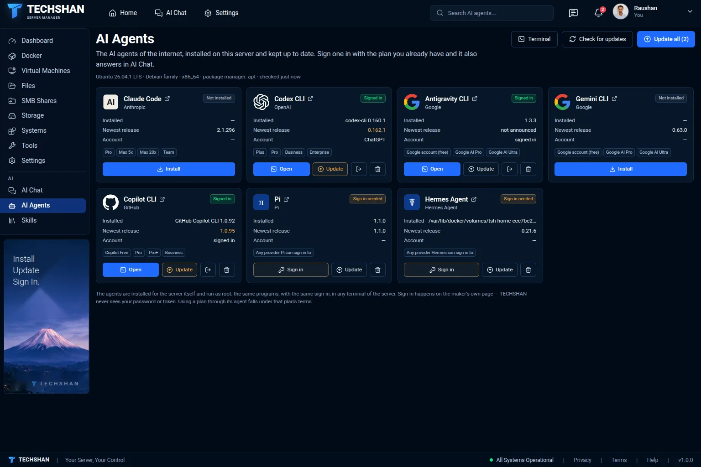

<p align="center">
  <a href="https://techshan.app"></a>
</p>

<h1 align="center">TECHSHAN</h1>

<p align="center">
  <b>Your Linux server, managed from the browser. Or just ask the AI to do it.</b><br>
  Docker, virtual machines, files, storage, network and firewall in one panel that runs on your own machine.
</p>

<p align="center">
  <a href="https://techshan.app"><b>techshan.app</b></a> ·
  <a href="#install">Install</a> ·
  <a href="#pricing">Pricing</a> ·
  <a href="mailto:support@techshan.app">Support</a>
</p>

<p align="center">
  
  
  
</p>

<p align="center">
  <a href="https://techshan.app"></a>
</p>

## Install

One command on the server, as root. It asks nothing, takes a few minutes, and prints the address of your panel.

```bash
curl -fsSL https://techshan.app/install.sh | sudo sh
```

Everything works for 30 days, and no Docker is needed to run it.

## Why TECHSHAN

- **Stop living in SSH.** Almost everything you would type into a terminal has a page that shows what is really on the machine.
- **Ask instead of click.** Write "why is the disk full?" and the AI assistant finds out on the server and tells you.
- **Your data stays home.** The panel runs on your server. No files, settings or conversations leave it.
- **Pay once.** $20 per server. No subscription, and the version you have never stops working.

## Server management

### Everything on one screen

CPU, memory, temperatures, drives, network and what happened on the server, as it happens. The dashboard above is the first thing you see after signing in.

### Docker

Containers, stacks, images, volumes, networks and registries. Give a container a graphics card (Intel, AMD, NVIDIA), devices of the server and privileges. Read logs and open a shell in the browser.

<p align="center">
  
</p>

### Virtual machines

Create and run KVM machines with a console in the browser, snapshots, disks and networks. Ubuntu, Debian, Fedora, Rocky Linux 9, openSUSE Leap 15.6 and Alpine install by themselves: the machine comes up ready to sign in.

<p align="center">
  
</p>

### And the rest of the server

| | |
|---|---|
| **Files and SMB shares** | Browse and edit files, share folders with Windows and macOS, manage who may open them. |
| **Storage** | Drives, health, pools, encryption, network drives and NFS exports. |
| **Server settings** | Network, firewall, users, services, packages and updates, scheduled jobs, certificates, backups, logs and a terminal. |
| **Users and roles** | Add an Administrator, an Operator or a Viewer, and choose which parts of the server each one opens. |

## AI on your server

### AI Chat

Write what you want done: "stop all running containers", "why is the disk full?". The assistant does it on the server and reports back. Every command shows as it runs, and a command that changes something waits for your yes.

Connect a Telegram bot of your own and manage the server from your phone the same way.

<p align="center">
  
</p>

### AI Agents and Skills

Install Claude Code, Codex, Antigravity, Gemini CLI, Copilot CLI, Pi and Hermes Agent on the server with a click. See each one's version, whether a newer one is out, and update. Sign one in with the plan you already pay for and it also answers in AI Chat. A shared library of skills is there for every agent on the server.

<p align="center">
  
</p>

## Pricing

| | |
|---|---|
| **First 30 days** | Free, with everything. |
| **License** | **$20, paid once**, for one server. It never expires and includes one year of updates. |
| **More updates** | $5 for another year, only when you want it. The version you have keeps working without it. |

- **Buy from your panel:** Settings › About & License › Buy a license. The key is made for that server and the panel fetches it by itself.
- **No license after the trial?** The Dashboard, Docker, Virtual Machines, SMB Shares and your workspace settings keep working. The AI pages, Files, Storage and the server's Settings pages are locked. Nothing running on your server is stopped.
- **New motherboard or a new server?** Sign in on [techshan.app](https://techshan.app/login) and move the license to it.

## What you need

A 64-bit Intel or AMD Linux server with systemd or OpenRC and glibc 2.34 or newer, and root access:

- Ubuntu 22.04 and later
- Debian 12
- Fedora
- Rocky Linux 9
- Arch
- openSUSE Leap 15.6

ARM servers and Alpine Linux are not supported yet.

**What the installer does to your server:** the program goes to `/opt/techshan`, its settings to `/etc/techshan`, its data to `/var/lib/techshan`. It uses the server's PostgreSQL (and installs it when missing), runs its own small Redis, starts five system services and opens the panel on port 3210.

## First steps

1. Open the address the installer prints, for example `http://your-server:3210`.
2. Create your account. The first account owns the server, and the 30-day trial starts.
3. Need more people? Settings › Users & Roles adds them.
4. Under My Server › Settings › Server Tools, tick the tools you want the panel to manage (Docker, virtual machines, Samba…).

## Manage

```bash
techshan status         # what is running, and the version
techshan logs           # follow the logs
techshan restart
sudo techshan update    # install the newest version
techshan url <address>  # set the address the panel is opened at
sudo techshan reset-password <email>   # a new password for an account that cannot sign in
sudo techshan backup    # copy the panel's database now (one is made every day and before every update)
sudo techshan restore   # put the database back from the newest copy
```

## Privacy

To find its license and to see whether a newer version is out, the server asks techshan.app every few minutes. With that question it sends its Server ID (made from the machine's hardware), the version of TECHSHAN, and a few facts about the machine: the operating system, the host name, the processor architecture, the number of processors, the amount of memory and how long it has been running.

Nothing else leaves the server: no files, no settings, no conversations, no account names. A server without internet keeps working, and its key can be installed by hand.

## Uninstall

```bash
sudo techshan uninstall
```

It asks before it removes anything, and asks separately whether your data goes too. Containers, virtual machines, shares and files on your server are not touched.

## Support

support@techshan.app · [Terms](https://techshan.app/terms) · [Privacy](https://techshan.app/privacy)

TECHSHAN is proprietary software of TECHSHAN. © TECHSHAN
